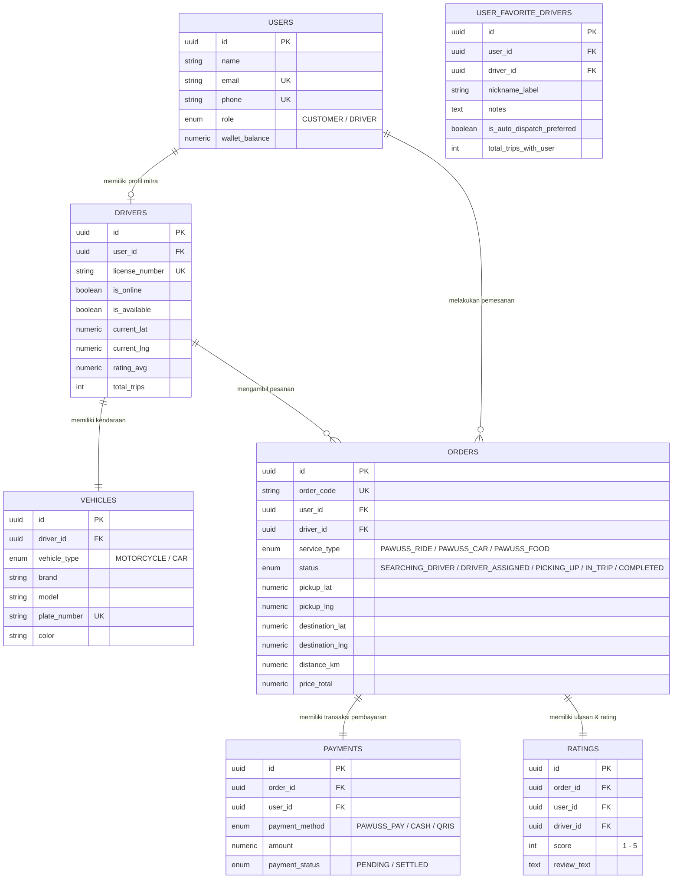

# 🛵 PaWuss - Ojek Online & Super-App Bandar Lampung

**PaWuss** adalah aplikasi super-app modern untuk layanan transportasi ojek online & pesan-antar di wilayah **Kota Bandar Lampung**. Dibangun dengan arsitektur scalable, modular, dan siap produksi.

---

## 🛠️ Tech Stack

- **Frontend**: React (Vite) + Tailwind CSS + Lucide Icons + Socket.io-client
- **Backend**: Node.js + Express.js + Socket.io
- **Database**: PostgreSQL (dilengkapi DDL Schema, indexing spasial, constraint relasional) + In-memory reactive fallback store untuk evaluasi cepat
- **Fitur Real-time**: WebSocket / Socket.io untuk live tracking GPS driver, state machine perjalanan, dan broadcast status

---

## 📐 1. Arsitektur Sistem & Alur Kerja

```mermaid
flowchart TD
    subgraph Client["Frontend (React + Tailwind)"]
        UI_User["Dashboard Pelanggan (Booking & Live Tracker)"]
        UI_Driver["Dashboard Mitra Driver (Accept & Ride Control)"]
        UI_Map["Canvas Radar & GPS Telemetri"]
    end

    subgraph Server["Backend (Node.js Express & Socket.io)"]
        REST_API["REST API Router (/orders, /drivers)"]
        Fare_Engine["Fare Engine (Haversine Geodesic Distance)"]
        Matcher["Matching Service (Nearest Driver Radius Search)"]
        Socket_Hub["WebSocket Hub (Rooms, Broadcast, Tracking)"]
        Simulator["Trip Lifecycle Simulator Engine"]
    end

    subgraph DataStore["Database & Storage"]
        PG_DB[("PostgreSQL Database\n(Users, Drivers, Orders, Payments, Ratings)")]
        Cache_Store[("In-Memory State Store")]
    end

    UI_User -->|1. Hitung Estimasi Jarak & Biaya| REST_API
    REST_API --> Fare_Engine
    UI_User -->|2. Buat Pesanan Baru| REST_API
    REST_API --> Matcher
    Matcher --> Cache_Store
    
    UI_User <-->|3. Room: order:ID (Real-time)| Socket_Hub
    UI_Driver <-->|4. Broadcast Lokasi GPS & Terima Order| Socket_Hub
    Socket_Hub --> Simulator
    Simulator -->|5. Update Status: Menjemput -> In Trip -> Selesai| Socket_Hub
    Socket_Hub --> UI_Map
```

---

## 🗄️ 2. Skema Database (PostgreSQL) & Relasi

File DDL lengkap tersedia di: `backend/db/schema.sql`



---

## 🚀 3. Cara Menjalankan Aplikasi Secara Lokal

### Prasyarat
- Node.js (v18 ke atas)
- npm

### Langkah 1: Jalankan Backend Server
Buka terminal 1:
```bash
cd backend
npm install
npm run dev
```
Backend akan berjalan di `http://localhost:5000` dengan WebSocket aktif di port yang sama.

### Langkah 2: Jalankan Frontend App
Buka terminal 2:
```bash
cd frontend
npm install
npm run dev
```
Buka browser di `http://localhost:3000`.

---

## 📱 4. Panduan Fitur & Demo Simulasi

1. **Dashboard Pengguna (Customer)**:
   - Pilih jenis layanan (**PaWuss Ride**, **PaWuss Car**, atau **PaWuss Food**).
   - Pilih rute (misal: *Grand Indonesia* menuju *Monumen Nasional*).
   - Sistem secara otomatis menghitung jarak menggunakan **Haversine Formula** geodesi dan menampilkan rincian tarif transparan (tarif dasar, jarak per KM, biaya platform, dan estimasi waktu).
   - Klik **"Pesan PaWuss Sekarang"**.

2. **Simulasi Siklus Lengkap (Real-time)**:
   - Klik tombol **"⚡ Jalankan Simulasi Live Tracking"** pada peta atau kartu order.
   - Perhatikan perubahan status bertahap:
     - 🔍 **Mencari Driver**: Sistem mencocokkan mitra di radius terdekat.
     - 🛵 **Driver Ditemukan & Menjemput**: Driver bergerak menuju titik jemput pelanggan secara real-time di atas radar canvas.
     - 🚗 **Dalam Perjalanan (In Trip)**: Pelanggan dijemput dan bergerak bersama driver menuju tujuan.
     - ✅ **Selesai (Completed)**: Tiba di tujuan, pembayaran diselesaikan via PaWussPay, dan modal rating bintang 1-5 muncul otomatis.

3. **Fitur Driver Langganan / Favorit (Priority Dispatch)**:
   - Pengguna memiliki kartu khusus **"⭐ Driver Langganan Saya"** yang menampilkan status online, rating, kendaraan, dan total trip bersama.
   - **Prioritas Otomatis**: Algoritma pencocokan driver (`matchingService.js`) secara otomatis memprioritaskan mitra langganan yang berada di radius penjemputan.
   - **Pesan Langsung**: Pengguna dapat memilih driver langganan tertentu sebelum memesan (`preferredDriverId`).
   - **Simpan Setelah Trip**: Di akhir perjalanan pada modal rating, pengguna dapat mencentang *"Simpan sebagai Driver Langganan"* beserta nama panggilan khusus.

4. **Dashboard Mitra Driver**:
   - Klik tombol **"Mitra Driver"** di pojok kanan atas navbar.
   - Anda dapat melihat status online/offline, penerimaan pesanan masuk (*incoming orders*), kontrol tombol status manual, serta performa penghasilan hari ini.
